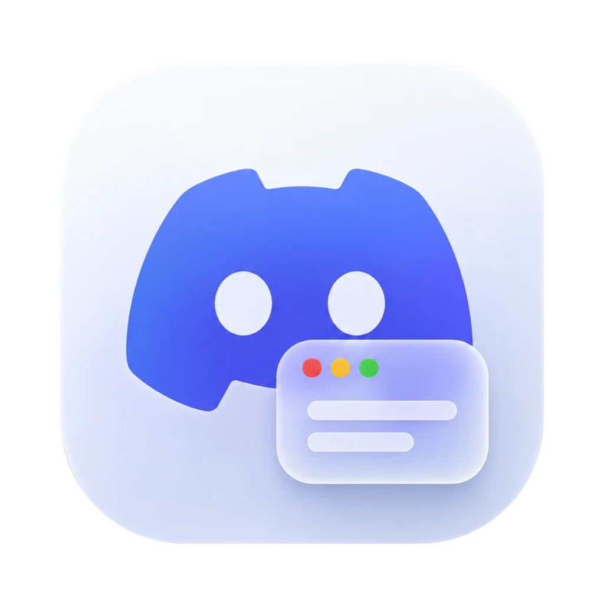

<p align="center"></p>

# Discord Activity para macOS

App de barra de menú que muestra en tu perfil de Discord la aplicación que tienes en primer plano en el Mac y, brevemente, qué haces en ella.

```
Viendo
  Visual Studio Code
  Editando main.swift
  en mi-proyecto
  12:34
```

Un solo archivo Swift, sin dependencias. Habla con Discord por su socket local (Rich Presence); no usa tu token ni toca tu cuenta.

## Instalación

Necesitas macOS 13 o posterior, Discord de escritorio y las Xcode Command Line Tools (`xcode-select --install`).

```bash
git clone https://github.com/ljmor/discord-activity.git
cd discord-activity
./install.sh
```

`install.sh` compila la app, la copia a `/Applications` y la abre. Si solo quieres compilarla, `./build.sh` la deja en `build/DiscordActivity.app`.

## Primer uso

1. Entra en [discord.com/developers/applications](https://discord.com/developers/applications), pulsa **New Application**, ponle cualquier nombre y copia su **Application ID**.
2. Pega ese ID en el diálogo que muestra la app al abrirse. Se puede cambiar después desde el menú, en **Client ID de Discord…**.
3. Concede el permiso de **Accesibilidad** cuando macOS lo pida. Sin él la app funciona, pero solo ve el nombre de la aplicación, no el título de la ventana (archivo, documento).
4. La primera vez que uses Chrome o Safari, macOS pide permiso para controlarlos. Sirve para leer el dominio de la pestaña activa.
5. En Discord, activa **Ajustes > Privacidad de actividad > Compartir actividad detectada**.

## Qué muestra

| Aplicación | Ejemplo |
| --- | --- |
| VS Code, Cursor, Windsurf, Xcode, Zed | `Editando main.swift` · `en mi-proyecto` |
| Word, Excel, PowerPoint, Pages, Numbers, Keynote | `Editando Informe.docx` |
| Chrome, Safari, Brave, Edge, Arc, Vivaldi | `En github.com` |
| Vista Previa, Acrobat | `Leyendo apuntes.pdf` |
| Figma | `Diseñando Landing` |
| Terminal, iTerm, Warp, Ghostty, kitty | `En la terminal` |
| Claude, ChatGPT | `Trabajando con Claude` |
| Slack, WhatsApp, Telegram, Mensajes, Teams, Signal | `Chateando` |
| Mail, Outlook | `Revisando el correo` |
| Spotify, Música | Aparecen como «Escuchando» |
| Cualquier otra | Solo el nombre de la aplicación |

El título de la tarjeta es el nombre de la aplicación en primer plano y el contador se reinicia al cambiar de aplicación. El icono sale de [dashboard-icons](https://github.com/homarr-labs/dashboard-icons) para las aplicaciones más conocidas y del App Store para el resto.

## Menú

- **Pausar**: borra el estado hasta que lo reanudes.
- **Abrir al iniciar sesión**.
- **Verbo en Discord**: Viendo, Jugando, Escuchando o Compitiendo en. Discord obliga a usar uno; no se puede quitar.
- **Client ID de Discord…**

## Privacidad

- Las aplicaciones de chat y correo, y cualquier aplicación que la app no conozca, nunca muestran el título de su ventana.
- De los navegadores solo sale el dominio, nunca la URL completa ni el título de la página. Las ventanas de incógnito de Chrome y derivados muestran solo `Navegando`.
- Las ventanas privadas de Safari **no** se detectan: su dominio se muestra igual. Usa **Pausar**.
- Los gestores de contraseñas (Contraseñas, Llaveros, 1Password, Bitwarden, LastPass) nunca aparecen.
- El estado se borra tras 5 minutos sin tocar teclado ni ratón.
- Para buscar el icono de una aplicación que no está en la tabla interna, la app envía su identificador (por ejemplo `com.microsoft.Word`) a la API pública de iTunes, una vez por aplicación. No se envían títulos ni nombres de archivo.

## Configuración

La app guarda sus ajustes en `~/.config/discord-activity/config.json`. Reiníciala después de editarlo a mano.

```json
{
  "clientId": "123456789012345678",
  "activityType": 3,
  "idleMinutes": 5,
  "hiddenApps": ["com.apple.Photos"],
  "icons": { "com.apple.finder": "https://ejemplo.com/finder.png" }
}
```

- `hiddenApps`: identificadores de aplicaciones que no quieres mostrar nunca.
- `icons`: URL pública de imagen para una aplicación concreta; tiene prioridad sobre el icono automático.
- `activityType`: 0 jugando, 2 escuchando, 3 viendo, 5 compitiendo.

Para saber el identificador de una aplicación:

```bash
osascript -e 'id of app "Finder"'
```

## Añadir o cambiar aplicaciones

Las reglas están en la función `describe()` de [main.swift](main.swift), y la tabla de iconos en `IconStore.known`. Edita, ejecuta `./install.sh` y listo.

Dos comandos ayudan a probar sin tocar Discord:

```bash
build/DiscordActivity.app/Contents/MacOS/DiscordActivity --samples
```

```bash
build/DiscordActivity.app/Contents/MacOS/DiscordActivity --dry-run
```

El primero imprime lo que se mostraría para varios títulos de ejemplo; el segundo, lo que detecta en vivo durante unos segundos.

## Problemas frecuentes

- **No aparece nada en Discord.** Abre el menú de la app: la primera línea dice qué pasa (Discord cerrado, falta el Client ID, en pausa). Comprueba también el paso 5 de «Primer uso».
- **Solo sale el nombre de la aplicación.** Falta el permiso de Accesibilidad. Tras recompilar sin un certificado de desarrollador, macOS lo invalida; quita la app de la lista en Ajustes del Sistema > Privacidad y seguridad > Accesibilidad y vuelve a añadirla.
- **Una aplicación sale sin icono.** No está en ninguna de las dos fuentes. Añade una URL en `icons`.

## Desinstalar

Sal de la app desde su menú, borra `/Applications/DiscordActivity.app` y, si quieres, sus ajustes:

```bash
rm -rf ~/.config/discord-activity
```

## Aviso

Proyecto independiente, sin relación con Discord Inc. «Discord» y su logotipo son marcas de Discord Inc.

## Licencia

[MIT](LICENSE)
